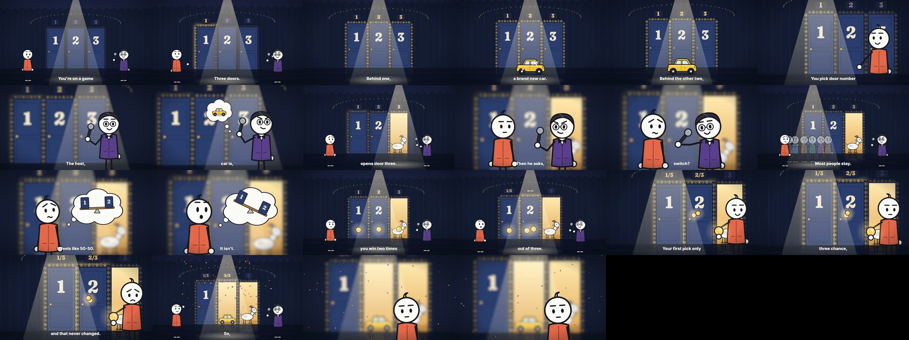

# stick-figure-shorts

A Claude Code skill that makes **stick-figure story videos** (20–60 s, 16:9 for YouTube by default, 9:16 on request). Claude writes the story, ElevenLabs voices it, and Claude draws every frame in code with [Remotion](https://www.remotion.dev): white round-head characters with stick limbs on moody one-light sets, plus music and sound effects. Every idea is **acted out by the characters**, so there are no fact cards or typography, only plain subtitles. No AI image or video generator is involved.



## Install
```bash
git clone https://github.com/deenukhan/stick-figure-shorts.git ~/.claude/skills/stick-figure-shorts
```
Then follow [SETUP.md](SETUP.md): Node 18+, ffmpeg, Python 3, an ElevenLabs connection, and a restart of Claude Code.

## Use
Open Claude Code in an empty folder and say:

> Use the stick-figure-shorts skill. Make a 30-second 16:9 story for YouTube about the Monty Hall problem: "You're on a game show. Three doors." Act the odds out (no fact cards) and end on a question.

## What's inside
| Path | What |
|---|---|
| `SKILL.md` | The recipe Claude follows: story → voice → word timings → shots in code → sound → render → QA, and the rules (animation first, plain subtitles) |
| `SETUP.md` | Install and setup guide, licences |
| `references/` | Story formulas and fact rules, the visual grammar (how to act a fact out, two motion styles), the full pipeline, sound design |
| `assets/template/` | "Three Doors" (16:9): the Remotion kit (`kit.tsx`: stick figure, camera, subtitles, soundtrack) and the complete film (`Film.tsx`) |
| `assets/examples/lost-phone-16x9/` | "The Lost Phone", a 59 s thriller in two styles (frames-only and full animation) |
| `scripts/` | Scaffold a film, ElevenLabs TTS with timings, whisper timings, cue generation, ambience beds, QA stills, render |

## Licences
Check ElevenLabs' plan terms before monetising (the free plan has no commercial licence) and Remotion's licence (free for individuals and companies of up to 3 people). See [SETUP.md](SETUP.md).

Made by [@neuraltech.ai](https://www.instagram.com/neuraltech.ai).
