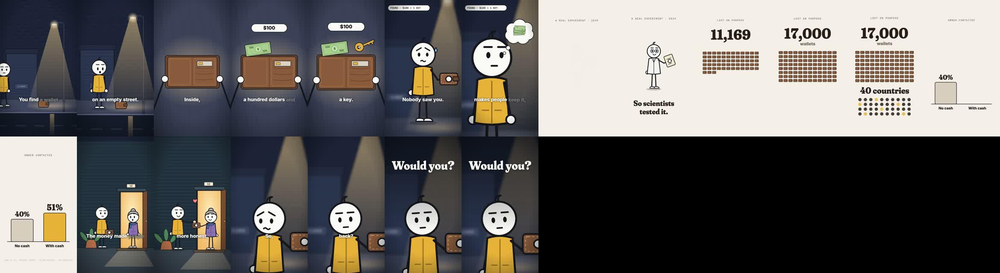

# stick-figure-shorts

A Claude Code skill that makes **20–40 second stick-figure story videos** (9:16, for Reels, Shorts and TikTok). Claude writes the story, ElevenLabs voices it, and Claude draws every frame in code with [Remotion](https://www.remotion.dev): white round-head characters with stick limbs, moody one-light sets, clean fact cards, karaoke captions, music and sound effects. No AI image or video generator is involved.



## Install
```bash
git clone https://github.com/deenukhan/stick-figure-shorts.git ~/.claude/skills/stick-figure-shorts
```
Then follow [SETUP.md](SETUP.md): Node 18+, ffmpeg, Python 3, an ElevenLabs connection, and a restart of Claude Code.

## Use
Open Claude Code in an empty folder and say:

> Use the stick-figure-shorts skill. Make a 30-second story: "You find a wallet with $100 in it. Nobody saw you." Add one real fact and end on a question.

## What's inside
| Path | What |
|---|---|
| `SKILL.md` | The recipe Claude follows: story → voice → word timings → shots in code → sound → render → QA |
| `SETUP.md` | Install and setup guide, licences |
| `references/` | Story formulas and fact rules, the visual grammar, the full pipeline, sound design |
| `assets/template/` | The Remotion kit (`kit.tsx`: stick figure, camera, captions, soundtrack) and a complete example film (`Film.tsx`) |
| `scripts/` | Scaffold a film, ElevenLabs TTS with timings, whisper timings, cue generation, ambience beds, QA stills, render |

## Licences
Check ElevenLabs' plan terms before monetising (the free plan has no commercial licence) and Remotion's licence (free for individuals and companies of up to 3 people). See [SETUP.md](SETUP.md).

Made by [@neuraltech.ai](https://www.instagram.com/neuraltech.ai).
